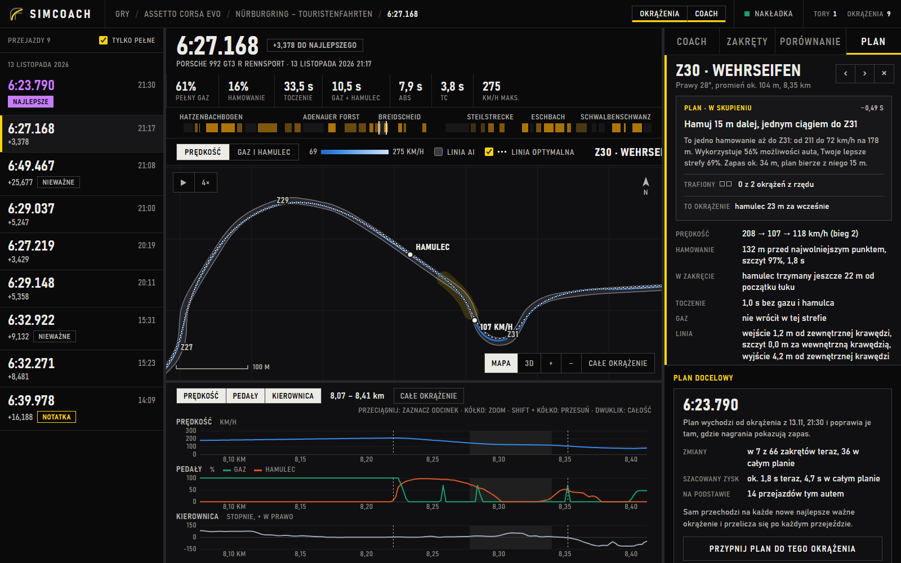
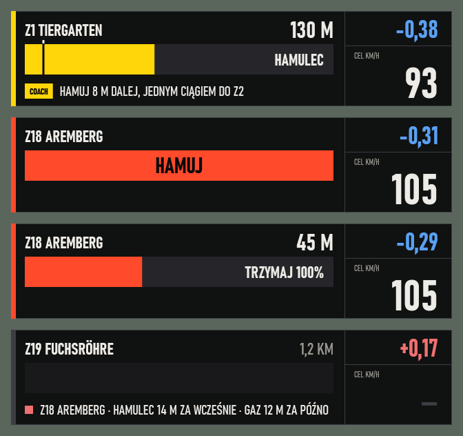
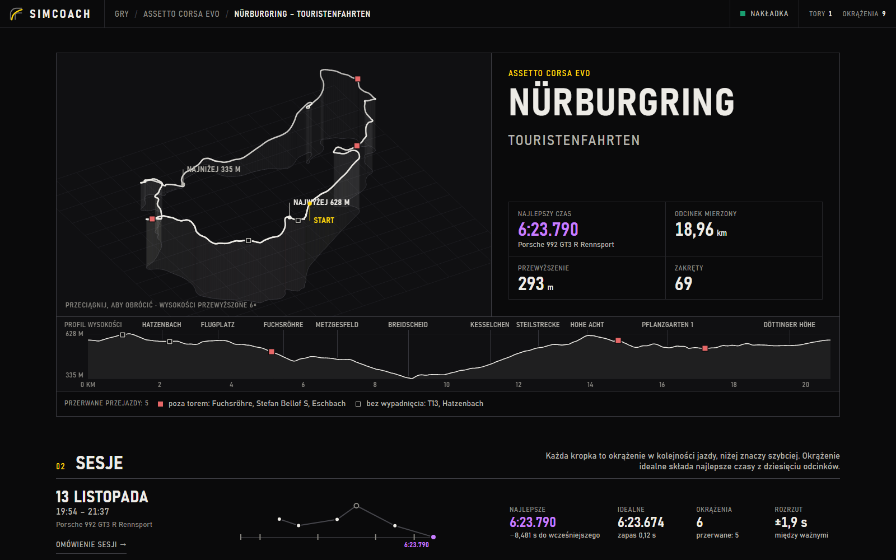
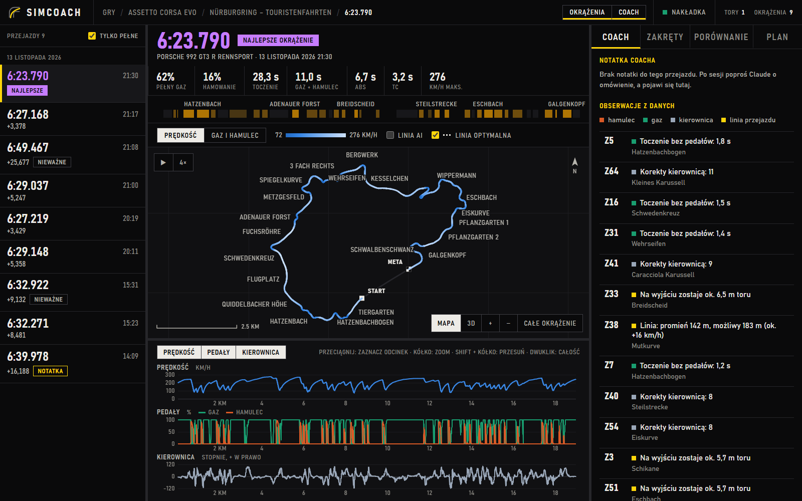
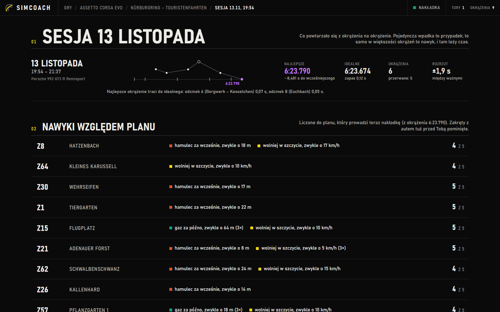

# SimCoach

A virtual driving coach for sim racing. A [SimHub](https://www.simhubdash.com/) plugin records every lap you drive, a local web app analyses the laps and works out where time is left on the table, and an in-game overlay coaches you towards a target lap with braking, lift and throttle cues, on screen and by sound.

Everything runs on your own PC. No account, no cloud, no telemetry leaves the machine.



> **Status:** a personal project that works for its author and is shared in case it helps someone else. It has been developed and tested with **Assetto Corsa EVO** on the Nordschleife (Touristenfahrten layout). The user interface is currently **in Polish**; code, comments and file formats are in English.

## What it does

**Records** each lap to a CSV file with a JSON summary next to it: position, speed, pedals, steering, gear, ABS and TC activity, fuel, tyre temperature and the distance to the cars around you.

**Analyses** a lap corner by corner:

- braking point, peak pressure, trail braking, coasting time, throttle pick-up, steering corrections, ABS and TC use
- the driven line against the track limits and against a computed minimum-curvature reference line
- a comparison of any two laps: time gained and lost along the track, and per corner
- sessions as a whole: lap times in the order they were driven, the ideal lap put together from ten sectors, consistency, and the things that kept coming back lap after lap

**Builds a target plan.** The overlay does not replay your best lap. It starts from it and moves the points where your own recordings show room: braking later where a later braking point has already worked, getting on the throttle earlier, carrying more speed where you have done so before. The plan moves in small steps, remembers where a later braking point ended off the track, and leaves out passes that were driven in traffic.

**Coaches while you drive.** A transparent, click-through window over the game counts down to the braking point, shows how long to hold the brake, and marks the lift and throttle points. The same cues are played as sounds, so your eyes can stay on the road.



Other things worth knowing:

- **Focus mode.** The plan can move its points in only five (or eight) corners at a time, the ones worth the most. A corner met on two laps in a row makes room for the next one.
- **The plan keeps itself current.** After every saved lap the plugin recomputes it and the overlay picks the new plan up between laps, never in the middle of one.
- **Only timed laps count.** On layouts with a run-up (the car park on the Nordschleife tourist layout), the drive to the start line is neither coached nor saved.

<details>
<summary>More screenshots</summary>

A track: its shape with elevation, where unfinished runs ended, and every session driven on it.



A lap: observations found in the data, the track map coloured by speed, speed and pedal traces.



A session review: habits measured against the plan.



</details>

## How it fits together

```
game ──> SimHub ──> SimCoach plugin ──> data/laps/<game>/<track>/<car>/*.csv + *.json
                         ▲                               │
                         │                               ▼
              data/guides/*.guide.txt  <──  Node app (analysis, target plan)  ──>  app window
              (the plan the overlay follows)             http://localhost:8377
```

- `plugin/` is the SimHub plugin: recorder, coach engine, overlay window and sounds (C#). It also keeps the app's server running while SimHub is open, and builds `SimCoach.exe`, the launcher.
- `app/` is the viewer and the analysis (Node.js, no dependencies, plain JavaScript in the browser).
- `data/` is created on first use and holds everything personal: laps, track models, plans, settings, logs. It is git-ignored.

## Requirements

- Windows 10 or 11
- [SimHub](https://www.simhubdash.com/). Developed with a licensed copy, which delivers data at 60 Hz.
- [Node.js](https://nodejs.org/). Developed and tested on v26; the app has no npm dependencies.
- The .NET Framework 4 C# compiler, which ships with Windows (`csc.exe`). No Visual Studio or .NET SDK is needed.
- A game supported by SimHub. Assetto Corsa EVO is the one this has been tested with; the recorder uses SimHub's game-independent data and adds a few AC EVO specific fields when they are available.

## Getting started

1. **Clone** the repository anywhere you like. The plugin writes to the `data` folder inside the clone; the location is fixed when the plugin is built.

2. **Build the plugin.** From the repository folder:

   ```powershell
   powershell -ExecutionPolicy Bypass -File plugin\build.ps1
   ```

   This also runs the recorder and sound tests and builds the launcher, `plugin\build\SimCoach.exe`. If SimHub is not in `C:\Program Files (x86)\SimHub`, add `-SimHubDir "D:\path\to\SimHub"`.

3. **Install it.** Close the game, then run `install-plugin.cmd`. It closes SimHub, copies `User.SimCoach.dll` into the SimHub folder, starts SimHub again and puts a SimCoach shortcut on the desktop and in the Start menu. Enable the "SimCoach Recorder" plugin if SimHub asks.

4. **Drive.** Complete laps are saved by themselves.

5. **Open the app.** Use the SimCoach shortcut, or the **Otwórz SimCoach** ("open") button on the SimCoach page in SimHub's left menu. See [Running the app](#running-the-app) below.

6. **Drive with the overlay.** The first plan is made by itself after your first valid lap. Run the game in borderless window mode: Windows does not let other windows draw over exclusive fullscreen. Window position, size and sounds are set on the overlay page of the viewer.

## Running the app

The app is a local web page served by a small Node.js server on `http://localhost:8377`, reachable from this machine only. You do not have to start that server yourself:

- **While SimHub is open, the plugin runs the server** in the background, without a console window. It starts it again by itself if it stops or if the app's files change (after a `git pull`, for instance). The SimCoach page in SimHub shows whether it is up.
- **The SimCoach shortcut** (`plugin\build\SimCoach.exe`) opens the app in a window of its own: no tabs, no address bar, its own taskbar icon. This is an Edge or Chrome "app" window with a separate browser profile kept in `data\window`, so it is not a tab of your everyday browser. Without SimHub the launcher starts the server itself.
- The server stops by itself once whoever started it is gone and the app window is closed. Closing SimHub while you are still looking at laps is fine.

Without Edge or Chrome the page opens in the default browser. `SimCoach.cmd` in the repository folder starts the launcher too; before the launcher is built it falls back to a console window and the default browser (`npm start` does the same). Set `SIMCOACH_PORT` to move everything to another port.

## Track limits and the timed lap

Two things about a track cannot be read from telemetry alone.

**Track limits.** If you own the original Assetto Corsa, SimCoach can take the limits and section names of a matching layout from your own installation. Put the path in `data/config.json`:

```json
{ "assettoCorsaDir": "D:\\Steam\\steamapps\\common\\assettocorsa" }
```

The first complete lap on a track then triggers a search for the matching layout. Without limits everything still works, except the line analysis. No game content is included in this repository.

**Timing lines.** Where the game times a lap between two lines that are not the start of the recording (the Nordschleife tourist layout), their positions are worked out from two or more laps with a known time:

```
node app/cli.js gates 1 --write
```

## Command line

`app/cli.js` prints the same analysis as text, which is handy for reviewing a session with an AI assistant or in a terminal:

```
node app/cli.js laps                 list the recorded laps
node app/cli.js analyze <lap>        findings and corner table of one lap
node app/cli.js compare <lap> <ref>  where one lap gains and loses against another
node app/cli.js target <lap> --why   the target plan starting from a lap, with reasons
node app/cli.js line <lap>           the reference line against the driven one
node app/cli.js guide <lap>          write the overlay's plan from a lap
node app/cli.js refresh              bring every plan up to date
```

`<lap>` is the number shown by `laps`, or a lap id.

## Coach notes

The viewer shows written notes next to the data they belong to. They are plain files, written by you or by whoever reviews your driving:

- `<lap file>.coach.md` next to a lap's CSV: a note for that lap (Markdown; `Z12` becomes a link to corner 12)
- `session_YYYYMMDD_HHMM.coach.md` in the same folder: a note for a session
- `data/guides/<name>.coach.json`: a cue or an adjusted target for single corners, which the overlay then shows in the game:

  ```json
  { "corners": { "18": { "note": "Release the brake earlier", "brakeShift": 10, "minSpeed": 105 } } }
  ```

## For dashboard builders

The plugin publishes what the overlay shows as SimHub properties (`Coach.Corner`, `Coach.MetresToPoint`, `Coach.Countdown`, `Coach.BrakeNow`, `Coach.ThrottleNow`, `Coach.Phase`, `Coach.TargetSpeed`, `Coach.Delta`, `Coach.Message`, `Coach.OverlayOn`) and a `ToggleOverlay` action, so you can build your own dashboard instead of using the built-in window.

## Privacy

- The viewer listens on `127.0.0.1` only and makes no outside requests.
- Recordings, track models, plans, settings and logs live in `data/`, which is excluded from version control. Log files contain local paths; do not post them without a look.

## Limitations

- The interface is in Polish. Translations are welcome; the strings live in `app/public/app.js` and in the overlay sources.
- Tested with one game, one track and one car. Other SimHub-supported games should record, but expect rough edges.
- The plugin is written in C# 5 on purpose, so that it builds with the compiler that ships with Windows.
- The target plan is an estimate from your own laps. It tells you where you have room, not what the car can do.

## Contributing

Issues and pull requests are welcome. Please keep code and comments in English, keep the app free of dependencies, and run `plugin\build.ps1` (which runs the tests) before sending a change to the plugin.

## Licence

[MIT](LICENSE).

SimCoach is an independent project. It is not affiliated with or endorsed by SimHub, Kunos Simulazioni, or any car maker or circuit named in it. All trademarks belong to their owners.
